# 🌐 GeoRoad Intelligence
### Autonomous Road Network Extraction from Satellite Imagery

[](https://www.python.org/)
[](https://pytorch.org/)
[](https://fastapi.tiangolo.com)
[](https://react.dev/)
[](LICENSE)

GeoRoad Intelligence is an autonomous, end-to-end deep learning system that extracts **topologically connected vector road networks** (intersection vertices and road segment edges) directly from raw high-resolution aerial and satellite imagery.

Inspired by the **SAM-Road** research methodology (Hetang et al., Carnegie Mellon University), the system unifies Meta AI's **Segment Anything Model (SAM ViT-B)** with a dual-channel geometric upsampler, 2D peak extraction, and a graph transformer topology decoder—complemented by a full-stack interactive web application for real-time visualization and GIS export.

---

## 📸 Interactive Web Studio Preview

The project includes an interactive web interface running on FastAPI and React 18:

- **Dual Canvas Modes**: `512x512 Crop (Native)` and `Full Canvas (Auto)`.
- **Dynamic Sensitivity Sliders**: Interactive tuning for `Road Threshold` (0.10–0.60) and `Intersection Threshold` (0.05–0.40).
- **KPI Metrics Dashboard**: Real-time counter of detected vertices, extracted edges, and graph connectivity degree.
- **Multi-Tab Viewer**: Vector Network Overlay (emerald roads, crimson intersections), Continuous Road Heatmap, and Topology JSON.
- **One-Click Export**: Downloads `road_network_<timestamp>.json` with coordinates and adjacency lists.

---

## 🏛️ System Architecture

```mermaid
graph LR
    A[Satellite Image 512x512x3] --> B[SAM ViT-B Backbone]
    B --> C[Latent Space 256x32x32]
    C --> D[4-Stage Geometry Decoder]
    D --> E[Road & Junction Heatmaps]
    E --> F[2D NMS Peak Detector]
    F --> G[Intersection Vertices V]
    C --> H[Graph Transformer Topology Decoder]
    G --> H
    H --> I[Vector Road Graph G=V,E]
    I --> J[FastAPI + React 18 Web App]
```



1. **Vision Foundation Backbone (`sam_encoder.py`)**: SAM ViT-B encoder (12 blocks, 768-dim, decomposed relative positional embeddings). Blocks 1–8 are frozen, while Blocks 9–12 and the 256-dim neck are fine-tuned to fit on consumer 4GB GPUs (NVIDIA GTX 1650).
2. **Dense Geometry Decoder (`geometry_decoder.py`)**: 4-stage `ConvTranspose2d` + `BatchNorm2d` + `GELU` upsampler predicting road centerline and junction probability heatmaps at full 512x512 resolution.
3. **2D Non-Maximum Suppression (`nms_extractor.py`)**: Local peak finder with 15x15 max-pooling window, adaptive quantile thresholding, and 16px minimum distance separation.
4. **Topology Decoder (`topology_decoder.py`)**: $K$-NN candidate formulation ($K=16, R_{\max}=64	ext{ px}$), sub-pixel bilinear feature sampling from SAM latents, spatial offset tokens, and a 2-layer Graph Transformer predicting edge connectivity.

---

## 📂 Repository Organization

```
GeoRoad_Intelligence_Final_Project/
├── 01_PBL1_EDA_and_Baselines/        # Milestone 1: Problem identification, CityScale/Sentinel-2 EDA
├── 02_PBL2_Clustering_and_HMM/       # Milestone 2: K-Means, DBSCAN & HMM Viterbi trajectory tracking
├── 03_PBL3_Ensemble_Learning/        # Milestone 3: Unit 5 Classical Ensemble Benchmark (CART, SVM, Voting, RF, GB)
├── 04_Final_Deep_Learning_Model/     # Core SAM-Road deep architecture, training & inference scripts
├── 05_Web_Application/               # Full-Stack Web Studio (FastAPI backend + React 18 frontend)
├── docs/                             # Comprehensive 7MB Project Review Report (.docx) & Slide Decks (.pptx)
├── requirements.txt                  # Unified Python environment requirements
├── .gitignore                        # Standard GitHub gitignore (ignores >100MB weights & datasets)
├── LICENSE                           # MIT License
└── start_web_app.bat                 # One-click Windows desktop launcher
```

---

## 📊 Milestone Progression & Benchmark Summary

| Review Milestone | Technique / Paradigm | Key Metric / Result | Output Deliverable |
| :--- | :--- | :--- | :--- |
| **PBL-I** | Spectral EDA & Linear Baselines | Verified 20-city spatial imbalance | Distribution reports & data analysis |
| **PBL-II** | K-Means, DBSCAN & HMM Viterbi | Unsupervised junction clustering | 11 visual evidence plots & trajectory logs |
| **PBL-III (Unit 5)** | Ensembles: Random Forest & Gradient Boosting | RF F1 = **44.47%**, GB F1 = **43.19%** | Feature importance, confusion matrices, PPT |
| **Final Model** | Deep SAM-Road Architecture | F1 = **65.48%**, 55% loss reduction | Connected vector graphs $G=(V, E)$ in JSON |
| **Production** | Full-Stack Web Studio | 185 ms inference, zero disk writes | FastAPI + React 18 interactive studio |

---

## 🚀 Quickstart Guide

### 1. Installation
Clone the repository and install dependencies:
```bash
git clone https://github.com/<your-username>/GeoRoad-Intelligence.git
cd GeoRoad-Intelligence
pip install -r requirements.txt
```

### 2. Download Base Weights
Download the official Meta AI SAM ViT-B base checkpoint:
```bash
cd 04_Final_Deep_Learning_Model
python download_weights.py
```

### 3. Launch the Interactive Web App
On Windows, simply run:
```cmd
start_web_app.bat
```
Or manually launch the backend:
```bash
cd 05_Web_Application/backend
python -m uvicorn main:app --host 127.0.0.1 --port 8000
```
Open your browser at: **`http://127.0.0.1:8000/app`**

### 4. Run Model Training
To train the deep SAM-Road architecture from scratch:
```bash
cd 04_Final_Deep_Learning_Model
python train.py
```

### 5. Reproduce Unit 5 Classical Ensemble Benchmark
To reproduce the PBL-III ensemble experiments:
```bash
cd 03_PBL3_Ensemble_Learning
python run_pipeline.py
```

---

## 📑 Comprehensive Documentation
Inside the [`docs/`](docs/) directory:
- **`GeoRoad_Intelligence_Project_Review_Report.docx`**: Complete, publication-grade 8-chapter project review report with mathematical derivations, layer-by-layer architectural specs, hardware optimizations, full web app mechanics, and viva voce Q&A.
- **`GeoRoad_Intelligence_PBL3_Complete_Presentation.pptx`**: Full 11-slide presentation deck for faculty review.

---

## 📜 License
This project is licensed under the MIT License - see the [LICENSE](LICENSE) file for details.
